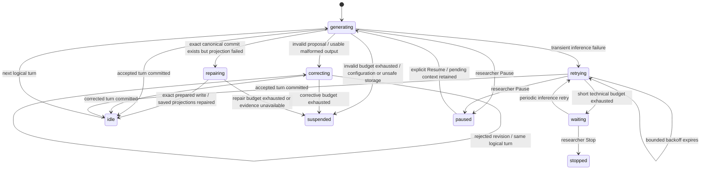

# Automatic error recovery and corrective retries

Current agent-decision contract, aggregated validation, small decoder bounds and stopped-run guidance: [Decision validation and recovery fixes](DECISION_RECOVERY.md). The verification section below records the original recovery release.

Automatic recovery defaults to enabled. `ExperimentConfig.recoveryConfig` is resolved and saved with new immutable run configurations. Existing configurations that omit this field use an explicitly audited effective recovery policy; their files, memories, snapshots and historical logs are not migrated or rewritten. Explicitly disabled recovery retains manual behavior. Previously recorded recovery policy is retained across restart even when an older immutable configuration has no recovery field. To change a saved run's settings, create a new run or explicitly configured research template.

## State machine

The existing lifecycle (`running`, `paused`, `stopped`, `completed`) is retained for compatibility. A separate persisted recovery phase explains what the single execution loop is doing:

`generating`, `correcting`, `retrying`, `waiting`, and `repairing` operate under the existing running lifecycle and writer/inference lease. `suspended` uses the paused lifecycle and requires researcher inspection. Explicit Pause and Stop cancel retry timers and abort the active HTTP inference. They cannot be undone by a delayed timer. Resume drains the old loop before launching another. A pending logical turn retains the same participant under both round-robin and event-driven scheduling.

## Settings

| `recoveryConfig` field | Default | Validation |
|---|---:|---|
| `enabled` | `true` | Boolean |
| `correctiveRetries` | 3 | Integer 0–20; retries after the initial attempt |
| `technicalRetries` | 5 | Integer 0–20; short retries after the initial attempt |
| `initialBackoffMs` | 2000 | Integer 1–60,000 ms |
| `maxBackoffMs` | 60000 | Integer 1–300,000 ms, at least initial backoff |
| `persistentConnectivityRecovery` | `true` | Boolean |
| `persistentRetryIntervalMs` | 60000 | Integer 1,000–3,600,000 ms |
| `auditRejectedAttempts` | `true` | Boolean; controls expanded inference evidence, not essential rejection records |

Short technical delays grow exponentially to the maximum. After that budget, periodic recovery remains enabled until the server returns or the researcher pauses/stops. The persistent interval has a one-second minimum to prohibit an unbounded rapid retry loop. No model sampling parameters or output modes are changed during recovery. A configured `LLM_REQUEST_TIMEOUT_MS` (default 600,000; 10–900,000 ms) or explicit `llmConfig.requestTimeoutMs` controls HTTP inference timeout and is recorded when explicitly supplied. A disconnected OpenAI-compatible server is retried at the selected endpoint and exact model; there is no model substitution or schema-mode fallback.

The Error Recovery fieldset in Experiment Setup exposes these settings, validates integer limits, and freezes with the saved configuration. The status banner distinguishes ordinary generation, corrections, inference retries, reconnection waiting, committed projection repair, suspension, researcher Pause/Stop, and planned world-event idleness. Rejected attempts and private corrections have an expandable audit view, separate from agent speech.

## Validation and transaction boundary

The controller prepares operational, memory, social and world decisions before any turn commit. Any failed memory operation now rejects the entire controller turn, including earlier otherwise-valid memory additions. The existing `MemoryManager` remains a pure preparation/diagnostic component; its per-operation audit is retained on rejected attempts rather than partially committed by the controller. All strict JSON Schema, configured operation/entry limits, target-reference, immutable-stat, location, permission, inventory and task checks remain in force.

A permitted self-reported failed activity or a scheduled environmental effect that cannot be fulfilled is distinct from an unauthorized proposal: existing valid outcome rules remain unchanged. Rejections never create dialogue, skip a participant, advance time, mutate inventories, modify observations/wake state or apply candidate memory/operational changes. Independently committed scheduler checkpoints remain authoritative and execute once.

A logical turn ID is `runId:turn:index`; attempt IDs add `:attempt:number`. The pending context is prepared once: original user/task stimulus, system prompt, retrieval state, authorized world/operational observations and sampling configuration. Only the latest complete correction is supplied to inference (all older corrections remain in audit/checkpoints). A correction is appended as a private system message marked `[EMERGENTSELF_CORRECTION_V1]`, with a stable violation code, explanation, explicit no-commit statement and the original uncommitted proposal encoded as data. It does not become conversation history or automatically become memory. Reserved correction markers echoed into dialogue, memory or operational fields are rejected without rewriting. Subsequent requests retain the original context and schema contract. If no usable model content exists, the same context is regenerated without inventing a previous proposal or adding a meaningless correction.

Successful turns retain `originalPrompt`, actual inference request, raw output, strict validation result and a `recoverySummary` with attempt count, correction count, technical failure count, retry time, total logical-turn time and correction success. Rejected attempts retain category, code, original proposal, proposed operations, correction, repeated-violation flag, simulation time, attempt number, commit status and recovery action. Expanded audit defaults on; disabling it still preserves essential raw/parsed rejected proposals and correction evidence. Wall-clock retry durations are research measurements only and never influence simulation time.

## Storage safety and restart

`execution_checkpoint` and `recovery_attempt` records extend the existing append-only event log. A rejected-attempt record includes its next recovery cursor in the same append, so a restart cannot keep the rejection while losing its correction. Checkpoints retain the frozen pending context, exact prepared request, counters, backoff deadline, effective recovery policy and explicit lifecycle. Accepted turns also record that policy without changing the original configuration hash. Checkpoints are kept out of the ordinary Angular event list; rejected attempt evidence remains inspectable and exports retain the full research log.

Before appending a turn the controller journals the complete prepared candidate and its hash. The conversation record remains the canonical write-ahead commit. Only an exact canonical ID/hash match authorizes recovery of saved state; neither inventory transactions nor memory proposals are rerun. A lost append acknowledgment is reconciled against the log. Known committed projection failures can retry saved projection repair with bounded backoff and without another inference. If a coherent canonical history proves that the exact journaled candidate was not committed, its unchanged write can be retried under the shared lease without generating another proposal. Mismatched, corrupted, unreadable or otherwise ambiguous evidence suspends rather than guessing; exhausted safe storage retries also suspend. Resume after repair checks canonical ordering and commit evidence before permitting further work. No unaudited retry proceeds when the recovery audit cannot be persisted.

At normal backend startup, `controller.restore()` locates the latest recovery-aware lifecycle checkpoint, acquires the existing stale-process-safe writer lease and repairs committed projections before inference. A committed turn advances the reconstructed index even if completion was never acknowledged. Interrupted requests receive a separately recorded `ATTEMPT_INTERRUPTED` event and a new attempt number. A pending rejected turn retains its private correction. Persisted Pause, Stop, reset, suspension and retry deadlines are respected. A stopped run is displayed without automatic inference. Multiple unfinished active runs or unverifiable storage produce a visible safe suspension; they are never selected by guessing.

Researcher world mutation is blocked while a frozen pending turn exists; finish it or explicitly Reset before advancing world time or issuing world wake interventions. This prevents a paused corrective retry from overwriting an intervening world change.

## Manual intervention and remaining limits

Researcher intervention remains necessary for an exhausted corrective budget, disabled persistent recovery after technical budget exhaustion, invalid application/model configuration, an ambiguous or corrupted commit log, exhausted safe projection repair, or unavailable audit storage. Resume from suspension explicitly grants a new short retry/correction budget while retaining the logical-turn ID, attempt history and correction context. Reset preserves its existing persistent-agent semantics and marks the old run non-resumable automatically; it does not erase research history.

There is one active HTTP inference per controller. Aborting an HTTP request cancels the client immediately; termination of server-side computation follows the model server's disconnect/cancellation semantics. Exact raw requests and outputs are evidence, not a claim that model sampling is deterministic. Complete pending contexts and retry evidence increase disk use in long experiments. If the backend cannot write evidence at all, it suspends and reports the failure; it cannot persist information to an unavailable storage device.

## Modified implementation

- `backend/src/recovery/recovery.ts`: validated settings, stable categories/subcodes and private correction construction.
- `backend/src/experiments/ExperimentController.ts`: bounded retry state machine, frozen contexts, atomic proposal validation, cancellation, commit reconciliation and restart restoration.
- `backend/src/llm/LlmAdapter.ts`: timeout/connection/server/configuration classification, abort support, pre-request journaling and correction-boundary validation. Current constrained-generation changes are documented in DECISION_RECOVERY.md.
- `backend/src/storage/JsonlStorage.ts`, `backend/src/index.ts`, `backend/src/api/experiment.ts`: durable cursor reads, startup restoration, configuration plumbing.
- `backend/src/research/ResearchService.ts`, `backend/src/branches/BranchService.ts`: frozen recovery settings in templates and supported timeout configuration in branches.
- `frontend/src/app/recovery-{controls,status}.component.ts`, `app.component.{ts,html}`, `services/experiment.service.ts`: locked configuration, recovery progress, rejected-attempt audit and SSE handling.
- `backend/test/recovery.test.cjs`, frontend recovery tests: automatic correction, Helena Turn 56, model outages, actual HTTP timeout, process crashes during inference/after commit, Pause/Stop, transaction atomicity and compatibility regressions. Existing test fixtures explicitly select manual mode where that behavior is under test; the memory-reference regression now requires whole-turn rejection.

## Verification results

- Backend: **244 tests pass**, including 41 recovery-focused tests; `npm test --prefix backend` includes a successful TypeScript build.
- Frontend: **72 browser tests pass** and the production Angular build passes. Existing template/style budget warnings remain below the build's error limits.
- Mocked desktop/mobile browser checks at 1366×768 and 390×844 pass: correction progress, retry/wait/suspension/Stop labels, frozen recovery controls, readable majority-height transcript, no horizontal overflow or browser errors.
- The live llama.cpp schema check was attempted; model discovery at `http://127.0.0.1:8080/v1/models` returned connection refused. Actual local-model/Ornith recovery and live grammar acceptance remain **unverified** in this environment. No constrained-generation schema rules or output modes were changed by this feature.

Automatic recovery applies to main experiment turns; standalone read-only research probes retain their existing explicit execution and error records. This avoids silently repeating a separately requested research measurement.
